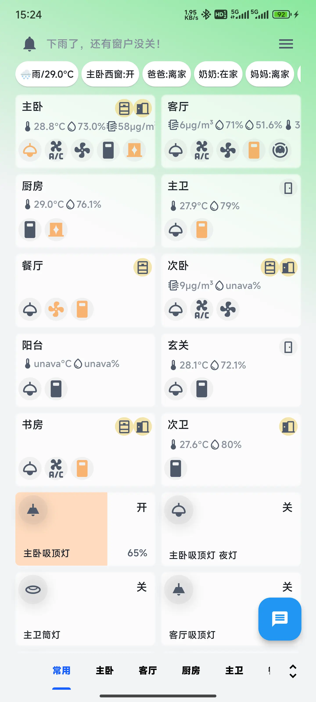
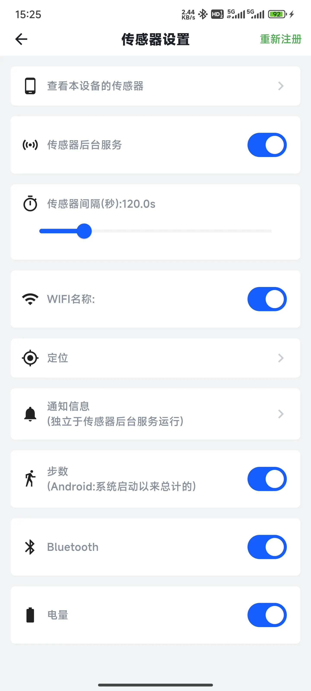
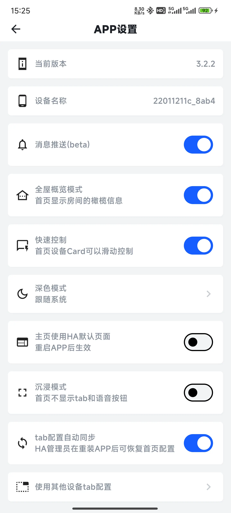

# SmartHouse

### 更快、更好用的 Home Assistant 客户端 —— 还能把 Home Assistant **装进手机里**

[English](README.md) · **简体中文**

[官网](https://191005.xyz/smarthouse/) · [App Store](https://apps.apple.com/app/id6753762531) · [Google Play](https://play.google.com/store/apps/details?id=cn.yzapp.flutter.ha) · [下载 APK](https://github.com/nesror/SmartHouse/releases/latest) · [使用教程](https://www.bilibili.com/video/BV16WCbYwEaH/)

---

| 首页 | 传感器 | 设置 |
| :---: | :---: | :---: |
|  |  |  |

---

## 💡 为什么选 SmartHouse

大多数 Home Assistant 客户端只是给你一个面板，而 **SmartHouse 还能自己当服务器。**

找一部闲置的 64 位 Android 手机，点一下，你就有了一个 7×24 小时在线的 Home Assistant 主机 —— 不用电脑、不用 NAS、不用云服务器、不用 root。吃灰的旧手机，从此上岗。

- ⚡ **启动更快、操作更友好** —— 原生 Flutter 客户端，不是 WebView 套壳
- 📦 **省掉一台硬件** —— 直接在口袋里的手机上运行 Home Assistant
- 🎙️ **真语音控制** —— Assist 语音管道，支持系统识别/播报与 Sherpa ONNX 离线识别
- 🔋 **深度 Android 集成** —— 传感器、通知监听、推送动作全部接入 HA
- 🌍 **6 种语言** —— 简体中文 / English / Français / 日本語 / Русский / العربية
- 🔒 **数据只走你自己的服务** —— 全部通信都指向你自己的 Home Assistant，不经第三方

## 📥 下载

| 平台 | 渠道 | 说明 |
| --- | --- | --- |
| Android | [Google Play](https://play.google.com/store/apps/details?id=cn.yzapp.flutter.ha) | 推荐大多数用户，自动更新 |
| Android | [GitHub Releases](https://github.com/nesror/SmartHouse/releases/latest) | 直装 APK（arm64-v8a / armeabi-v7a / x86_64），支持应用内自更新。使用独立应用 ID，可与商店版共存 |
| iOS | [App Store](https://apps.apple.com/app/id6753762531) | 需要 iOS 15.6 或更高版本 |
| iOS | [GitHub Releases](https://github.com/nesror/SmartHouse/releases/latest) | 未签名 IPA，供自签名 / 侧载使用 |

## ⚡ 在手机本地运行 Home Assistant（Android）

这是 SmartHouse 最与众不同的能力：Home Assistant **直接跑在你的设备上**，不需要任何外部服务器。

- **一键安装** —— 自动下载官方容器镜像、解压并启动，全程图形化操作，无需命令行，也不要求你会 Docker
- **免 root** —— 基于 `proot` 容器技术，不修改系统分区，安全无忧
- **大陆网络友好** —— 内置多个镜像源并自动回退，支持自定义镜像源；下载中断可断点续装，不必重头再来
- **进度透明** —— 通知栏实时显示下载 / 解压 / 启动各阶段进度，可随时取消
- **一键接管** —— 安装完成后一键把本机实例设为应用服务地址，立刻开始配置你的家
- **局域网共享** —— 同一局域网内的其它设备可直接访问 `http://<手机IP>:8123`
- **常在后台** —— 支持开机自启与 App 启动自动拉起，并提供各品牌机型的后台保活引导
- **镜像更新** —— 秒级检测新版本，原地升级，配置数据完整保留

> 想让它 7×24 小时无头运行？插上电、关闭电池优化，它就是一个安静的智能家居主机。

## 🏠 功能一览

**全屋设备一手掌控**

- 自动同步 HA 实体并按房间（Tab）组织展示；新增实体自动发现，一键加入房间
- 支持灯光、风扇、空调、窗帘、媒体、摄像头、扫地机、天气、传感器等常见设备
- 卡片编辑与排序、消息实体固定展示、首页卡片滑动快速控制
- 全屋概览模式，每个房间显示橄榄信息摘要
- 多服务地址管理，内外网地址自动切换；支持 WebView 密码登录与长期访问令牌登录

**Assist 语音助手**

- 基于 Home Assistant Assist Pipeline 的文本与语音对话
- 支持系统语音识别/播报，也支持 Sherpa ONNX 离线识别
- 可自由切换语音管道与语音引擎

**传感器与通知联动（Android）**

- 前台服务定时上报电量、Wi-Fi、步数、蓝牙、定位，驱动回家/离家等自动化
- 通知监听服务把手机通知回传 HA
- 推送动作支持打开实体、播放媒体、调用服务

**媒体与历史**

- 浏览 HA 媒体源，应用内播放或外部打开
- 查看实体历史曲线

**个性化**

- 深色模式与多套主题色
- Dashboard 配置同步与本地保存，重装 App 后可恢复
- 沉浸模式，也可选择把 HA 自带 Lovelace 页面作为首页
- 界面支持 简体中文、English、Français、日本語、Русский、العربية

**VIP**

- 可选的应用内购买，用于支持项目持续维护，并解锁语音对话等高级功能

## 🎬 了解与观看

| | |
| --- | --- |
| 官网与介绍 | <https://191005.xyz/smarthouse/> |
| 使用教程视频 | <https://www.bilibili.com/video/BV16WCbYwEaH/> |
| 更新日志视频 | <https://www.bilibili.com/video/BV1Y8411179b/> |
| 订阅号更新日志 | <https://mp.weixin.qq.com/s/Fce0EhnMYU-uy96yIH9_0A> |

## 📌 使用须知

- **Android**：Android 7.0+ · **iOS**：15.6+
- **本地安装 Home Assistant**：需要 64 位 Android 设备，并预留至少 **6GB** 可用存储空间；首次启动 HA 需初始化数据库，约 **1~3 分钟**
- 长期把手机当主机使用，建议保持插电并关闭本 App 的电池优化
- 连接远程 Home Assistant 需要你自行提供可访问的服务地址，本应用不提供服务器
- 与 Android 版不同，iOS 版不包含本地 HA 运行环境，也不包含 Android 的传感器/通知桥接能力

## ❓ 帮助、反馈与功能请求

遇到 Bug，或者希望增加某个功能？本仓库就是 **使用帮助与问题反馈** 的地方。

- 🐞 [提交 Bug 或功能请求](https://github.com/nesror/SmartHouse/issues/new/choose)
- 💬 [浏览已有 Issue](https://github.com/nesror/SmartHouse/issues)

提交时请尽量附上：

1. SmartHouse 版本
2. 设备类型与系统版本（Android / iOS）
3. Home Assistant 版本
4. 有截图更好；实体控制类问题请附上该设备的完整状态属性

这些信息通常能让一次「用不了」在一轮沟通内变成一次修复。

## ⭐ 支持项目

如果 SmartHouse 对你有帮助，欢迎点一个 ⭐ Star —— 它能让更多 Home Assistant 用户找到这个项目。

- ⭐ [给仓库点 Star](https://github.com/nesror/SmartHouse/stargazers)
- 📝 [告诉我们还缺什么](https://github.com/nesror/SmartHouse/issues/new/choose)
- ☕ 应用内 VIP 购买同样会直接支持项目的持续维护

## 📄 声明

SmartHouse 是独立的第三方客户端，与 Home Assistant 及 Open Home Foundation **没有任何隶属、背书或赞助关系**。「Home Assistant」是其各自所有者的商标。你的 Home Assistant 服务及配置由你自行负责。

---

**SmartHouse** · 让每一部手机都能成为智能家居的大脑

